# 用户体验优化｜无人机专区

**PRD · V0.9.2 · 2026-11-01**

本次作业围绕下单选购过程，新增「凑单助手」和「购物车按店铺批量删除」两个功能，并优化加购反馈、按店凑单入口和操作后的状态衔接。
由于无法真实体验完整业务流程，本次将范围集中在能够通过页面操作观察和分析的选购环节，终点为进入订单确认。
未涉及部分没有在本次原型中体现。

**评审入口：**[查看 Demo](无人机选购优化原型.html) · [查看完整异常状态图集](design/exception-states/index.html) · [查看项目说明与设计过程](README.md)

## 1. 背景、问题与目标

### 1.1 当前问题

前期通过小程序录屏、截图与商品加购操作，梳理了入口、页面层级和主要跳转关系。选购阶段的主要问题集中在两类任务。

| 用户任务 | 观察到的表现 | 本次解决的问题 |
| --- | --- | --- |
| 本店未满起送，继续选商品 | 「去加购」能够定位对应门店，但仍需自行寻找可加商品；受限提示出现后，缺少直接完成本店凑单的路径 | 提供本店商品选择入口、价格筛选与金额联动，减少反复查找和尝试 |
| 已选商品触发购买限制 | 蜜雪冰城（海岸城店）的部分商品数量和组合在加购后触发限制，通用提示包含「换店加购」；但换店不能补足本店起送金额 | 保留原购买校验，在操作附近表达受限状态，并将凑单任务与普通加购操作衔接起来 |
| 整理多店购物车 | 页面支持多单一起购买，购物车已有逐项调整和全车清空，但缺少按店一次删除 | 增加门店级批量删除，保留其他店已选商品 |

商品加购限制来自单店样本观察，不能据此判断平台整体存在规则错误，也不能确认具体原因和改动的影响范围，因此本次优化只限于购买路径与反馈，没有对具体规则进行改动。

### 1.2 用户价值与业务目标

| 用户价值 | 业务目标 | 计划观察的指标 |
| --- | --- | --- |
| 在本店内更快找到补足起送的商品 | 提高未满起送任务的完成率，减少选购中断 | 凑单入口使用率、使用助手后的本店达标率 |
| 选择时即可看到金额变化和购买限制 | 减少无效加购与重复试错 | 受限后的重复失败率、调整后成功加购率 |
| 一次删除某店全部商品，保留其他选择 | 降低购物车整理成本 | 按店删除完成率、任务操作次数及耗时 |
| 调整后获得一致的购物车和起送状态 | 帮助用户继续完成订单确认 | 进入订单确认率、金额与商品状态一致性 |

## 2. 用户与需求范围

目标用户为在无人机专区选购的普通消费者，包含本店新客；不涉及会员和优惠券场景。

| 范围 | 内容 |
| --- | --- |
| 新增功能 | 凑单助手；购物车按店铺批量删除 |
| 流程优化 | 未达起送门店入口汇总；选中商品、金额和进度联动；受限时加号置灰并提示原因；加减购和删除后的关联更新 |
| 沿用能力 | 商家／品类切换、规格选择、普通加购、逐项减购、按店起送判断、全车清空、最多三单一起购买的约束及订单确认入口 |
| 不涉及 | 会员、优惠券、活动裂变、取餐导航、客服扩展、配送及飞行调度、载重规则、支付与售后、登录恢复及新增角色权限 |

## 3. 核心功能与用户步骤

### 3.1 凑单助手

入口：商品页底部汇总当前购物车中未达起送的门店，展示各店名称、差额和「推荐凑单」；购物车中的对应门店也保留凑单入口。

| 步骤 | 用户操作 | 页面与系统动作 |
| --- | --- | --- |
| 1 | 点击某店「推荐凑单」 | 定位该店商品区域，打开该店助手，不混入其他店商品 |
| 2 | 查看推荐或切换价格区间 | 按当前规格的单件价格筛选；不清空已选内容 |
| 3 | 点击商品、再次点击或选择其他商品 | 独立选中或取消；允许多选，不强制互斥 |
| 4 | 调整规格与数量 | 重算本次加购金额、本店预览金额、差额和进度 |
| 5 | 确认加购 | 校验本次所选商品；成功后更新实际购物车，再判断本店是否满起送 |
| 6 | 加购成功后继续操作 | 已满起送可继续选购；仍不足时可继续凑单；各店分别处理，达标店的底部入口单独消失 |

补充规则：

- 标题为「凑单助手」。当前版本推荐区域为单品列表，之后的版本也可以根据具体规则提供预先组合好的凑单方案。
- 「自己选」清空本店未提交选择并返回本店商品区域；普通关闭在当前选购过程中保留草稿。
- 受限时加号置灰并说明原因，仍允许查看规格、取消选择或减购；调整后重新判断是否可加。
- 确认尚未补足起送的有效选择，区分成功加购与达到起送是两个不同的结果。
- 筛选无匹配商品时，金额选项栏保留，商品区为空；有匹配商品但当前不可加时，保留商品和受限状态。

### 3.2 购物车按店铺批量删除

入口：购物车内各门店标题行的删除图标，作用范围为该店已选全部商品及规格。垃圾桶图标固定使用同一种灰色覆盖全部状态。

| 步骤 | 用户操作 | 页面与系统动作 |
| --- | --- | --- |
| 1 | 打开购物车 | 读取当前购物车，展示最新门店分组和商品内容 |
| 2 | 点击某店删除图标 | 弹窗明确目标门店与商品数量，说明其他店商品保留 |
| 3a | 点击取消 | 返回购物车，全部商品保持不变 |
| 3b | 确认删除 | 提交目标门店删除；等待期间显示「删除中…」，阻止重复确认 |
| 4 | 查看处理结果 | 成功后删除目标门店分组，更新数量、金额、起送入口和结算状态；失败或超时保留当前列表，分别提示「商品删除失败，请重试」或「请求超时，请重试」，不展示独立重试按钮；再次点击本店垃圾桶重新确认，或刷新后再操作。超时后再次提交时，系统先核对上次结果，避免重复处理 |
| 5 | 继续选购 | 仍有其他店则继续整理或选购；删除最后一家店则显示空购物车和返回选购入口 |

按店删除、逐项减购和全车清空并存。按店删除不会影响其他店的加购状态。

## 4. Happy Path演示入口

[打开 Demo](无人机选购优化原型.html)。桌面左侧提供场景入口；以下步骤用于观察两个新增功能及其前后衔接。

### 路径 A：从本店未满起送到进入订单确认

1. 点击「本店未满起送」，购物车中已有蜜雪冰城的冰鲜柠檬水，金额为5.20元，本店起送为17元。
2. 点击该店「推荐凑单」，进入助手；查看推荐及金额筛选。
3. 选择12元的芋泥鲜牛乳，预览金额变为17.20元、差额变为0、进度达到100%；此时实际购物车尚未提交本次选择。
4. 再次点击可取消，进度恢复；重新选中后点击「确认加购」。
5. 成功后返回选购页，该店凑单入口消失；进入购物车并继续到订单确认。

### 路径 B：按店整理多店购物车

1. 点击「整理三店购物车」，打开底部购物车。
2. 选择一家店的删除图标，核对弹窗中的门店与数量；可先取消，观察内容不变。
3. 再次打开并确认，目标店商品一次移除，其他店商品、规格和数量保留。
4. 剩余门店未达起送时，继续通过其凑单入口选购；也可逐店删除，观察最后一家删除后的空状态。

Happy Path以可交互原型展示；网络失败、等待和超时等边界状态通过第9节附图展示，分别呈现触发条件、页面反馈和恢复入口。

## 5. 业务泳道图

### 5.1 凑单助手

下图按用户、页面和业务支撑职责分泳道。业务支撑表示需求依赖的能力，不预设现有系统名称或接口。

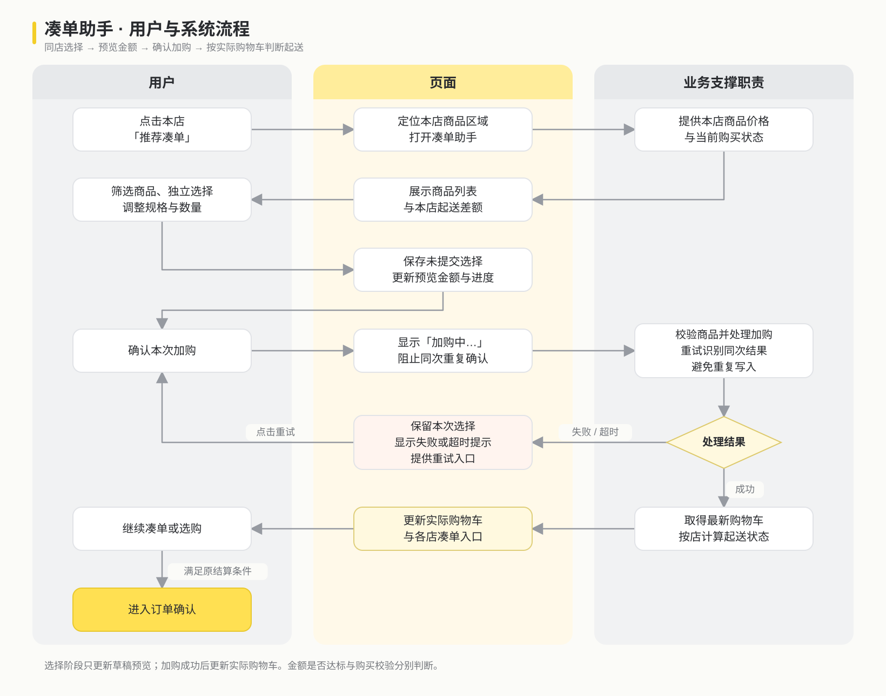

展开流程定义

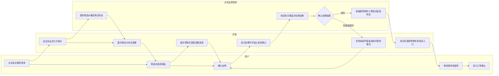

### 5.2 购物车按店铺批量删除

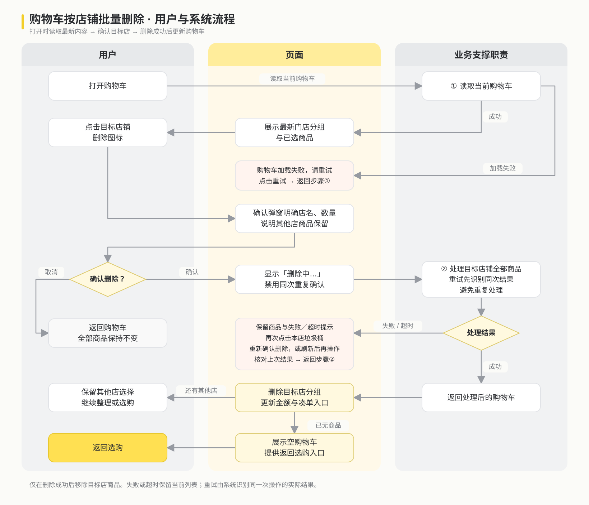

展开流程定义

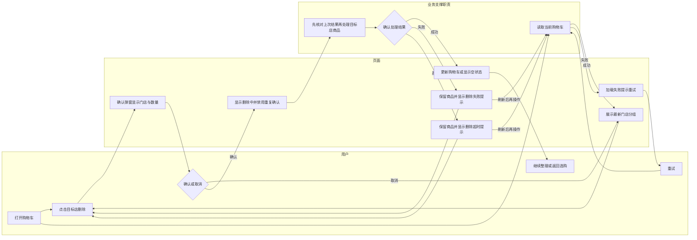
本版以打开购物车后读取最新状态为前提，不单独展示确认期间购物车变化。

## 6. 金额规则、需求字段与参数

### 6.1 凑单金额规则

本版按店内商品金额表达凑单进度，不包含包装费和配送费。正式业务口径仍需确认折前／折后统计、规格差价、加料和优惠数量变化的处理方式。

| 概念 | 规则 |
| --- | --- |
| 本店已有金额C | 该店实际购物车商品行金额之和 |
| 本次加购金额D | 助手已选商品的当前规格单价×数量，再求和 |
| 预览金额P | C+D；其他门店金额不参与 |
| 剩余差额G | max(0, 本店起送门槛 T − P) |
| 进度 | T > 0 时为 min(100%, max(0%, P ÷ T × 100%)) |
| 达标条件 | 金额达到门槛且购买校验通过；最终按成功后的实际购物车判断 |
| 计算精度 | 使用整数分计算，展示为元，最多保留两位小数 |
| |

筛选按单件当前规格价：低于 5 元、5≤价格<10、10≤价格<15、15≤价格<20、20≤价格<25、价格≥25。
推荐优先展示当前可购买商品；其中单件能够补足打开助手时差额的商品按价格升序展示，可以按业务需求进行调整，其余保留目录顺序。进入后固定顺序，选择、改数量时不重新排列，暂也不计算最优商品组合。
勾选、取消、增减数量和改规格均重算；切换筛选不改变已选金额；确认成功后清除已提交草稿，避免与实际购物车重复累计。

### 6.2 新增需求所需信息

以下字段名为需求描述用名
（ps可能涉及已有同名字段或接口，已有信息的取得方式、可信来源和更新时机需要实际在接入前确认，不在假设范围内）

| 信息／建议字段 | 类型与用途 | 来源或生成方 | 缺失处理 |
| --- | --- | --- | --- |
| 门店标识 storeKey` | 文本；确定凑单和删除目标 | 门店／购物车业务提供 | 不按截断店名推断，暂停该次操作并刷新 |
| 商品与规格 `itemKey / options` | 文本及对象；区分商品行 | 商品与购物车能力 | 保留其他有效选择，要求重新选规格 |
| 数量 `quantity` | 正整数；加购与删除数量 | 购物车和用户草稿 | 不以未知数量生成删除确认 |
| 当前规格价 `unitAmount` | 整数分；展示与筛选 | 商品价格能力 | 不参与可确认的金额计算 |
| 起送门槛及统计金额 `minimum / eligibleAmount` | 整数分；计算差额和进度 | 交易业务确认口径并提供 | 不承诺达标，保留已选内容 |
| 购买结果 `canAdd / reason` | 布尔值及原因；加号状态 | 购买校验能力 | 提交时仍需判断，不能从标签猜测资格 |
| 助手草稿 `draftItems` | 商品、规格、数量集合 | 本次操作生成 | 无选择时确认按钮不可用 |
| 当前筛选 `priceRange` | 枚举；控制可见列表 | 用户操作生成 | 默认推荐凑单 |
| 目标门店商品集合 `targetItems` | 列表；明确批量删除范围 | 当前购物车按门店归集 | 无商品则不展示该店删除入口 |
| 本次操作标识 `operationKey` | 文本；同次操作重试识别 | 新增操作流程生成 | 不把连续两次合法加购误判为重复 |
| 选购会话／凑单任务 `sessionKey / topupTaskKey` | 文本；归集同一会话内的门店凑单行为 | 新增统计流程生成，边界见第8节 | 无标识事件单独记录，不重复拼凑任务 |
| 处理结果 `result / latestCart` | 状态与购物车内容 | 加购／删除处理能力 | 超时保留当前展示，重试时核对处理结果 |

### 6.3 交互参数（假设版）

| 参数 | 设计值 | 判断方式 |
| --- | --- | --- |
| 点击受理反馈 | 100ms 内 | 选择态、按钮态或处理中提示可见 |
| 持续等待提示 | 超过 500ms | 保持加载／处理中状态，避免无反馈等待 |
| 超时反馈 | 5s 未取得处理结果 | 显示「请求超时，请重试」，提供重试入口 |
| 重复操作控制 | 同一次处理仅一个有效结果 | 等待期间禁用重复确认；重试不重复新增商品 |

## 7. 状态机

### 7.1 凑单助手

「已选择」是上层状态，包括未达标预览、达标预览和选择受限三个子状态；子状态均支持继续选择、筛选和普通关闭。筛选空状态只改变可见列表。

| 当前状态 | 触发事件 | 判断条件 | 系统动作 | 下一状态 |
| --- | --- | --- | --- | --- |
| 未打开 | 点击某店入口 | 该店有商品且未达起送 | 定位门店，取得商品与金额，打开助手 | 待选择 |
| 待选择／已选择 | 点击筛选 | 区间有匹配商品 | 更新可见列表，保留选择 | 待选择／已选择 |
| 待选择／已选择 | 点击筛选 | 区间无匹配商品 | 保留选项栏，商品区域置空 | 筛选空状态 |
| 筛选空状态 | 切换区间 | 新区间有匹配商品 | 恢复商品列表 | 待选择／已选择 |
| 待选择／已选择 | 勾选、取消、改数量或规格 | 操作有效 | 重算预览金额与进度，保留页面位置 | 未达标预览／达标预览 |
| 已选择 | 购买校验变化 | 当前商品或组合不可加 | 置灰新增动作，显示原因，保留可调整操作 | 选择受限 |
| 选择受限 | 减购、取消或调整规格 | 重新校验允许 | 恢复对应操作并重算金额 | 未达标预览／达标预览 |
| 未达标预览／达标预览 | 确认加购 | 有有效选择且金额信息完整 | 提交一次加购，按钮显示加购中 | 加购处理中 |
| 加购处理中 | 返回成功 | 商品写入成功 | 更新实际购物车，清除已提交草稿 | 已加入、未满起送／本店已满起送 |
| 加购处理中 | 返回明确失败 | 未完成本次写入 | 提示「加购失败，请重试」，保留选择 | 加购失败 |
| 加购处理中 | 等待超时 | 5s 未取得结果 | 提示「请求超时，请重试」，保留选择 | 加购超时 |
| 加购失败／加购超时 | 点击重试 | 同一次操作 | 识别既有处理结果，避免重复写入 | 加购处理中／已加入 |
| 已加入、未满起送 | 点击继续凑单 | 实际本店仍未达标 | 保留门店入口，重新开始选择 | 待选择 |
| 本店已满起送 | 返回选购 | 实际本店已达标 | 只移除该店凑单入口 | 继续选购 |
| 助手任意可操作状态 | 点击自己选 | 用户主动退出助手选择 | 清空本店未提交草稿，返回本店 | 普通选购 |
| 待选择／已选择 | 普通关闭后重开 | 当前选购过程仍有效 | 恢复草稿，再计算当前购买状态 | 待选择／已选择 |

### 7.2 购物车按店铺批量删除

| 当前状态 | 触发事件 | 判断条件 | 系统动作 | 下一状态 |
| --- | --- | --- | --- | --- |
| 购物车未打开 | 打开购物车 | 开始读取当前内容 | 显示加载状态，暂不提供删除操作 | 加载中 |
| 加载中 | 读取成功 | 有门店商品 | 展示最新分组和操作入口 | 可整理 |
| 加载中 | 读取成功 | 无商品 | 展示空购物车与返回选购 | 空购物车 |
| 加载中 | 读取失败 | 无法取得内容 | 提示「购物车加载失败，请重试」 | 加载失败 |
| 加载失败 | 点击重试 | 用户再次读取 | 重新加载，不误显示空购物车 | 加载中 |
| 可整理 | 点击某店删除 | 该店有商品 | 展示店名、数量与影响范围 | 待确认 |
| 待确认 | 点击取消 | 尚未提交 | 关闭确认，保留全部商品 | 可整理 |
| 待确认 | 确认删除 | 目标门店明确且无待核对结果 | 提交该店删除，显示删除中，禁用重复确认 | 删除处理中 |
| 待确认 | 确认删除 | 上次删除结果尚未确认 | 显示删除中并核对上次结果；已完成则刷新，否则继续处理目标店 | 可整理／空购物车／删除处理中 |
| 删除处理中 | 返回成功 | 仍有其他店商品 | 删除目标店，更新金额与入口 | 可整理 |
| 删除处理中 | 返回成功 | 已无商品 | 清除金额与凑单入口，显示空状态 | 空购物车 |
| 删除处理中 | 返回失败 | 本次删除未完成 | 提示「商品删除失败，请重试」，保留商品 | 删除失败 |
| 删除处理中 | 等待超时 | 5s 未取得结果 | 提示「请求超时，请重试」，保留当前列表 | 删除超时 |
| 删除失败 | 再次点击本店删除图标 | 目标店仍有商品 | 重新展示店名、数量与影响范围，等待用户确认 | 待确认 |
| 删除失败 | 刷新购物车 | 用户重新读取内容 | 读取最新购物车，恢复门店删除入口 | 加载中 |
| 删除超时 | 再次点击本店删除图标 | 目标店仍在当前列表 | 重新展示店名、数量与影响范围，等待用户确认 | 待确认 |
| 删除超时 | 刷新或重新进入购物车 | 用户重新读取内容 | 读取最新购物车，已删除店铺不恢复；仍有商品时允许重新操作 | 加载中 |
| 加购或删除处理中 | 重复点击 | 同一操作尚未结束 | 不新增重复处理 | 原处理中状态 |
| 操作中离开页面 | 再次进入购物车 | 需恢复当前结果 | 读取当前购物车，已删除商品不恢复 | 加载中 |

### 7.3 其他边界

无价格、门槛或目标门店信息时，禁止生成确定金额或错误删除目标，图片加载失败可使用占位。
登录失效、重新登录和无权限由已有账号流程处理。

## 8. 埋点与验证指标

公共信息：发生时间、当前页面、匿名选购会话、目标门店、凑单任务标识及本次操作标识。
统计任务定义：同一选购会话中，某门店未达起送时首次打开助手，生成一个凑单任务标识 `topupTaskKey`。
                          同店重复打开、切换筛选和分多次加购沿用该任务；实际达标、整店删除或选购会话结束时结束任务。再次从达标变为未达标后打开助手，建立新任务。
                         将进入订单确认或连续30分钟无选购操作作为会话结束条件。

| 事件 | 触发时机 | 关键参数 | 用途 |
| --- | --- | --- | --- |
| 凑单入口曝光／点击 | 未达标店入口可见／被点击 | 门店、差额、入口位置 | 判断触达和使用 |
| 助手选择变化 | 勾选、取消、改数量或规格 | 商品、规格、数量、筛选、选择前后差额 | 分析选择路径 |
| 加购结果 | 本次处理取得结果 | 操作标识、成功／失败／超时、原因、耗时 | 统计完成与重复失败 |
| 本店起送达标 | 成功更新后由未达标转为达标 | 门店、来源、本次金额 | 判断助手后的任务完成 |
| 按店删除意图／确认／取消 | 对应用户动作发生 | 门店、数量、商品行数 | 分析整理意图与取消 |
| 按店删除结果 | 删除处理取得结果 | 操作标识、结果、耗时、是否空车 | 统计成功和恢复 |
| 进入订单确认 | 原结算校验通过后进入 | 本次选购会话、门店数、是否使用新功能 | 观察选购后续结果 |

同一次操作重试以操作标识去重。
助手内凑单达标率＝由助手确认加购使本店从未达标变为达标的任务数÷已开始的凑单任务数，按 `topupTaskKey` 去重；通过普通选购达标的任务另记恢复路径，不计入该指标分子。
按店删除完成率＝删除成功任务数÷确认删除任务数。操作耗时、重复失败和其他店误变更作为过程指标。

## 9. 异常状态附图

下列附图与本版范围对应。点击编号可查看原图；[打开完整图集](design/exception-states/index.html)。

| 凑单与加购 | 页面状态 |
| --- | --- |
| [01 商品组合受限](design/exception-states/output/01-已选商品组合受限.png) 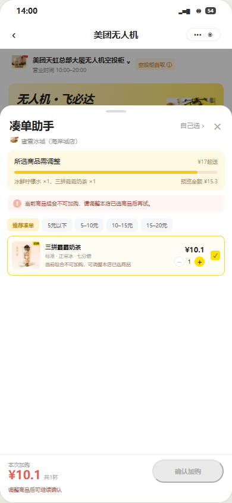 | [02 商品暂不可售](design/exception-states/output/02-商品暂不可售.png) 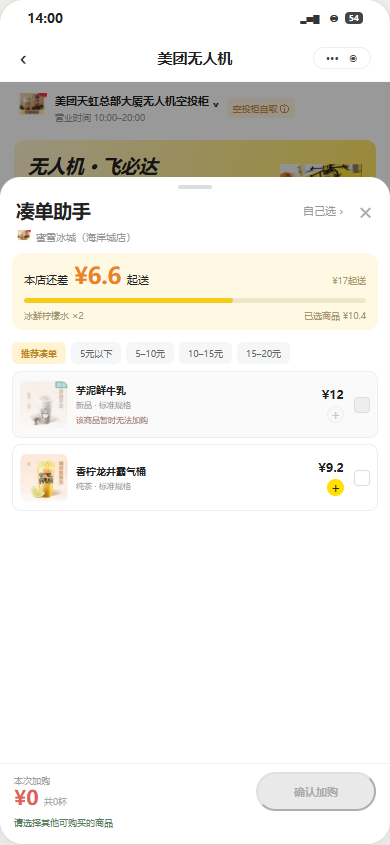 |
| [03 加购失败](design/exception-states/output/03-加购失败.png) 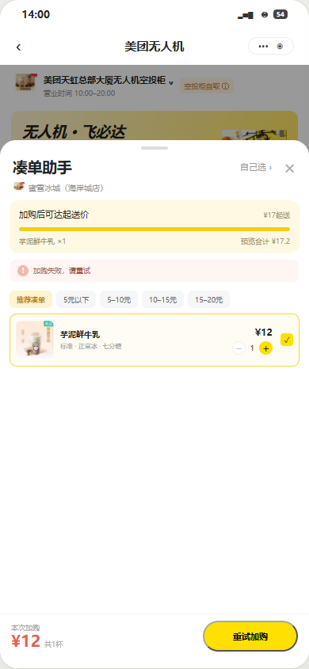 | [04 加购请求超时](design/exception-states/output/04-请求超时.png) 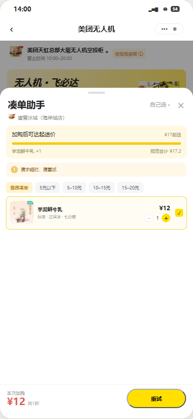 |
| [07 筛选无匹配商品](design/exception-states/output/07-筛选后无可用商品.png) 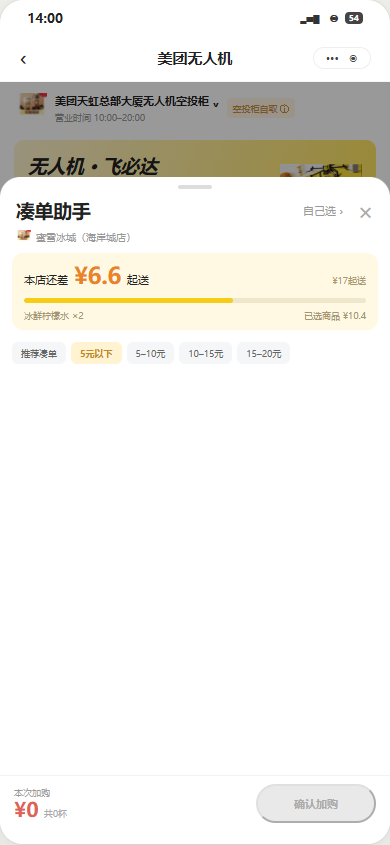 | 价格选项保留，用户可切换其他区间；切换不清空已有选择。 |

| 购物车按店铺批量删除 | 页面状态 |
| --- | --- |
| [05 商品删除失败](design/exception-states/output/05-商品删除失败.png) 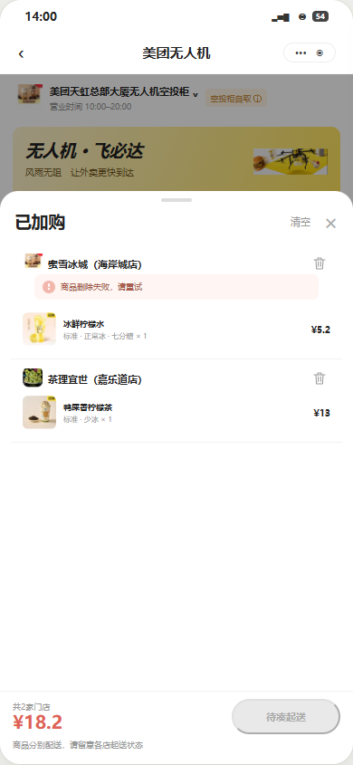 | [06 删除最后一家后的空状态](design/exception-states/output/06-移除最后一家店后的空状态.png) 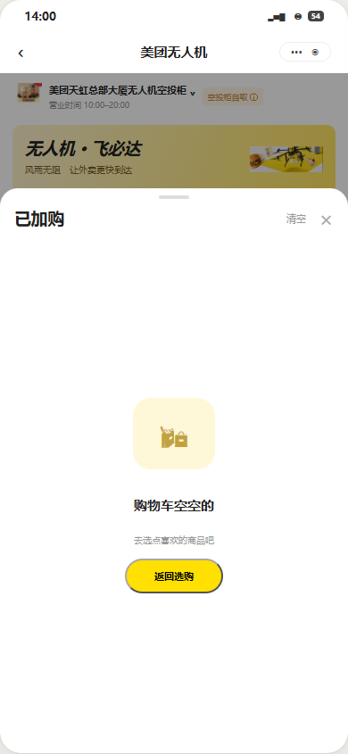 |
| [08 购物车加载失败](design/exception-states/output/08-购物车加载失败.png) 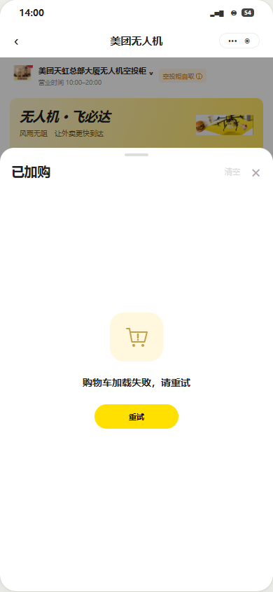 | [09 按店删除处理中](design/exception-states/output/09-按店删除处理中.png) 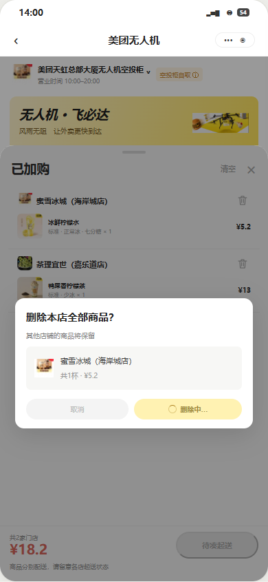 |
| [10 按店删除超时](design/exception-states/output/10-按店删除请求超时.png) 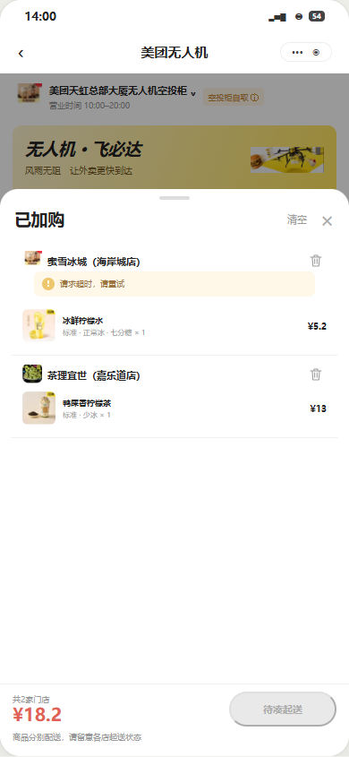 | 保留该店商品和其他店选择，重试由系统识别同次处理结果。 |

## 10. 可判断的验收标准

| 编号 | 条件与操作 | 可判断的结果 |
| --- | --- | --- |
| AC01 | 多家店都未达起送，查看底部并点击其中一家 | 各店差额分别展示；点击进入对应助手且定位同一门店 |
| AC02 | 勾选一件商品，再次点击同一商品 | 第一次选中、第二次取消；金额和进度往返一致，页面不重新弹出 |
| AC03 | 连续选择不同商品 | 可同时选中；合计为全部已选商品金额，无互斥 |
| AC04 | 修改规格或数量 | 价格、数量、差额和进度同步；保留当前滚动位置 |
| AC05 | 切换金额筛选 | 按单件规格价归类；5元和25元归入约定区间；已选内容不丢失 |
| AC06 | 当前价格区间无匹配商品 | 筛选栏保留，商品区域为空，不展示其他价位商品 |
| AC07 | 点击自己选 | 未提交选择清空，实际购物车不变，返回本店商品区域 |
| AC08 | 普通关闭并在同一选购过程中重新打开 | 恢复本店草稿，按当前购物车重新计算 |
| AC09 | 本次选择触发单品或组合限制 | 新增加购动作不可用，显示原因；减购或取消后允许状态可恢复 |
| AC10 | 选择有效但仍不足起送的商品并确认成功 | 商品进入购物车，仍可继续凑单；本店入口不消失 |
| AC11 | 预览已达标但尚未确认 | 购物车内容不变；确认成功并实际达标后，该店入口才消失 |
| AC12 | 有其他未达标门店时完成一家凑单 | 只移除该店入口，其他门店差额与入口继续存在 |
| AC13 | 打开按店删除确认后取消 | 目标店及其他店全部商品、规格、数量不变 |
| AC14 | 确认删除一家店并成功 | 该店全部商品行消失，其他店商品、规格与数量保持；金额重新计算 |
| AC15 | 删除最后一家店成功 | 显示空购物车，金额和徽标归零，凑单入口消失，结算不可用 |
| AC16 | 点击确认加购或删除 | 100ms内给予受理反馈；等待超过500ms仍有处理中状态，重复点击不新增同次处理 |
| AC17 | 已确认加购或删除失败 | 加购失败保留已选商品及重试入口；删除失败保留购物车内容，仅提示「商品删除失败，请重试」，无独立重试按钮，本店垃圾桶保持灰色；再次点击该图标须重新确认，刷新后也可再次操作 |
| AC18 | 处理超过5s未取得结果 | 显示「请求超时，请重试」；加购保留重试按钮，按店删除不提供独立重试按钮，用户再次点击灰色垃圾桶重新确认或刷新后操作；系统核对上次结果，同次操作只保留一个有效结果 |
| AC19 | 购物车读取失败后点击重试 | 显示加载失败而非空车；读取成功后按最新内容恢复入口 |
| AC20 | 卡顿后离开并重新进入 | 读取当前购物车；已删除商品不重新出现，已加入商品不重复新增 |
| AC21 | 缺失必要金额或目标信息 | 不以0或截断店名补值，不承诺达标或删除其他店商品 |

本次以异常附图表达页面反馈，AC16–AC20中涉及等待、网络结果与恢复的条目是接入时的验收要求；Happy Path与选择、金额、按店整理的交互在Demo中展示。

## 11. 待确认信息与后续验证

1. 起送统计按折前还是折后金额，付费规格、加料、包装费如何计入；数量增加是否改变价格。
2. 商品与组合购买资格的可信来源，哪些状态能够在用户点击前取得。
3. 批量加购／删除是否能返回完整处理结果；若可能部分成功，如何表达结果并避免重试重复处理。
4. 当前购物车读取和操作结果恢复能力，以及建议响应时间是否满足实现条件。
5. 通过用户任务走查验证是否能独立完成凑单、取消选择、按店删除与失败重试，再确定是否需要进一步调整信息与入口。

以上信息影响后续落地方式，但不改变本次的两个核心功能和选购阶段范围。